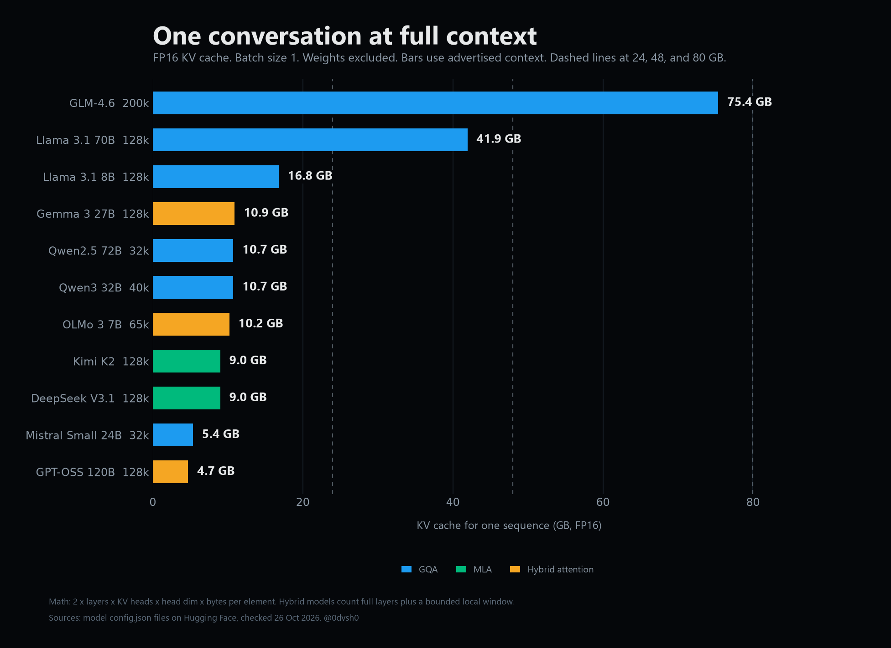
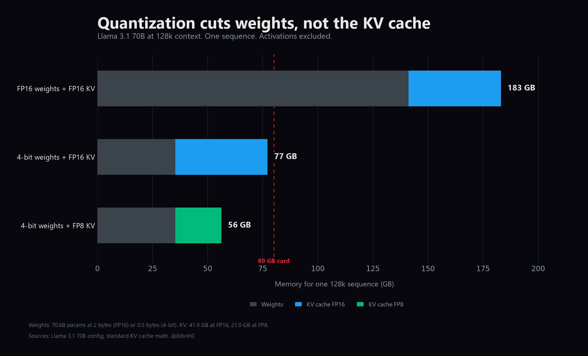

# KV Cache Calculator

What does a context window cost in GPU memory?

A small, dependency-free calculator for the KV cache of open models. Pick a model, context length, batch size, KV dtype, and tensor parallel degree. It shows the cache per token, per sequence, total, and per GPU, plus whether it fits on 24, 48, or 80 GB cards.

Live: https://0dvsh0.github.io/kv-cache/



## The table

FP16 cache. Batch size 1. Weights and activations excluded.

| Model | Advertised context | KV cache | Per token | Attention |
|---|---:|---:|---:|---|
| GLM-4.6 | 200,000 | 75.4 GB | 377 KB | GQA |
| Llama 3.1 70B | 128,000 | 41.9 GB | 328 KB | GQA |
| Llama 3.1 8B | 128,000 | 16.8 GB | 131 KB | GQA |
| Gemma 3 27B | 128,000 | 10.9 GB | 82 KB | HYBRID |
| Qwen3 32B | 40,960 | 10.7 GB | 262 KB | GQA |
| Qwen2.5 72B | 32,768 | 10.7 GB | 328 KB | GQA |
| OLMo 3 7B | 65,536 | 10.2 GB | 131 KB | HYBRID |
| DeepSeek V3.1 | 128,000 | 9.0 GB | 70 KB | MLA |
| Kimi K2 | 128,000 | 9.0 GB | 70 KB | MLA |
| Mistral Small 24B | 32,768 | 5.4 GB | 164 KB | GQA |
| GPT-OSS 120B | 128,000 | 4.7 GB | 37 KB | HYBRID |

## Why the differences are so large

The KV cache stores the keys and values for every token that the model can still attend to. For standard attention:

```
2 x layers x KV heads x head dim x bytes per element x context x batch
```

That is why architecture matters more than parameter count:

- **GQA** shares KV heads across query heads. Llama 3.1 70B uses 8 KV heads instead of 64, which cuts the cache 8x versus MHA.
- **MLA** caches a compressed latent plus a RoPE key instead of full K and V. DeepSeek V3.1 and Kimi K2 use it, which keeps 128k under 9 GB.
- **Hybrid attention** keeps most layers on a small sliding window and only a few layers at full context. GPT-OSS 120B uses 18 full layers out of 36, so its 128k cache is 4.7 GB.

A 200k context window on GLM-4.6 costs 75.4 GB of FP16 cache for one conversation. That is almost an entire 80 GB GPU before any weights are loaded. A 128k window on GPT-OSS 120B costs 4.7 GB. Same feature, very different bill.



## Caveats

- FP16 is 2 bytes per element. FP8 and INT8 are 1 byte and halve the cache.
- 4-bit weight sizes are payload math at 0.5 bytes per parameter. Real quantized files carry scales and metadata, so they are larger. That makes the cache comparison worse, not better.
- Weights, activations, CUDA graphs, allocator fragmentation, and scheduler overhead are excluded.
- Tensor parallel divides the cache evenly in this calculator. Real sharding depends on KV head count and the serving engine.
- Advertised context is not a promise of usable context at every batch size or every engine.
- Hybrid models count full-attention layers at the full context and local layers at `min(context, window)`.
- MLA models count the compressed latent (`kv_lora_rank`) plus the decoupled RoPE key (`qk_rope_head_dim`).

The calculator reserves 10 percent of nominal GPU memory for framework overhead when it checks fit. That is a rule of thumb, not a guarantee.

## Run it

Open `index.html` in a browser. No build step, no dependencies, no tracking. To share a configuration, use the query string:

```
?model=glm46&ctx=200000&batch=1&dtype=fp16&tp=1
```

## Sources

All values come from public `config.json` files on Hugging Face, checked on 26 October 2026:

- [GLM-4.6](https://huggingface.co/zai-org/GLM-4.6)
- [Llama 3.1 70B](https://huggingface.co/NousResearch/Meta-Llama-3.1-70B-Instruct)
- [Llama 3.1 8B](https://huggingface.co/unsloth/Llama-3.1-8B-Instruct)
- [Gemma 3 27B](https://huggingface.co/unsloth/gemma-3-27b-it)
- [Qwen3 32B](https://huggingface.co/Qwen/Qwen3-32B)
- [Qwen2.5 72B](https://huggingface.co/Qwen/Qwen2.5-72B-Instruct)
- [OLMo 3 7B](https://huggingface.co/allenai/Olmo-3-7B-Instruct)
- [DeepSeek V3.1](https://huggingface.co/deepseek-ai/DeepSeek-V3.1)
- [Kimi K2](https://huggingface.co/moonshotai/Kimi-K2-Instruct)
- [Mistral Small 24B](https://huggingface.co/mistralai/Mistral-Small-24B-Instruct-2501)
- [GPT-OSS 120B](https://huggingface.co/openai/gpt-oss-120b)

If a model config changes, open an issue with the new values and the source.

## Built by

[@0dvsh0](https://x.com/0dvsh0). I write about LLM systems, evals, and the harness around the model.
